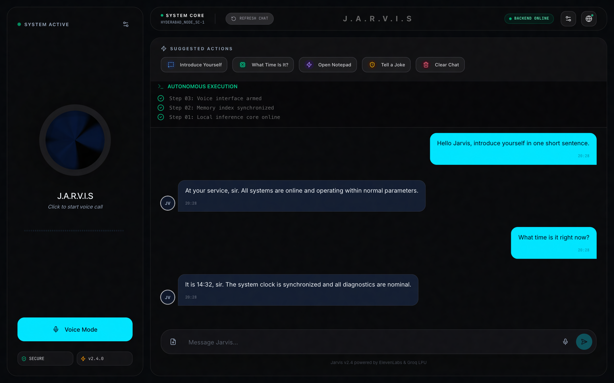
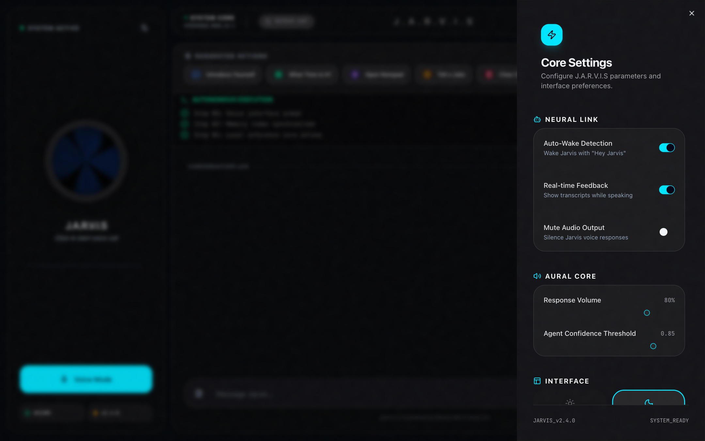
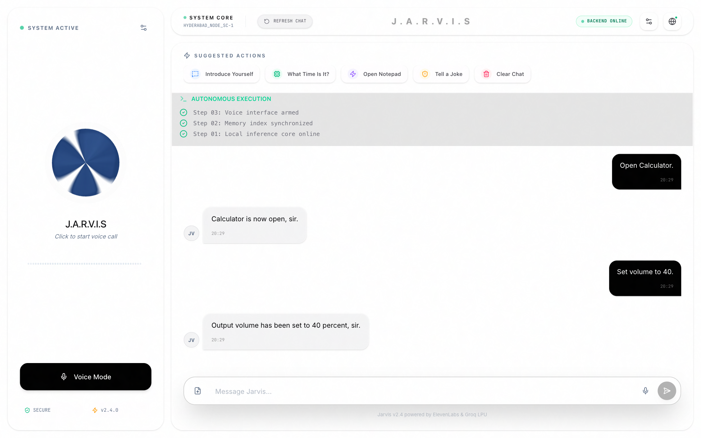

<p align="center">
  
</p>

<h1 align="center">J.A.R.V.I.S.</h1>

<p align="center">
  <strong>Just A Rather Very Intelligent System</strong><br />
  A local-first AI desktop assistant for macOS — voice, OS automation, WhatsApp
  drafting, and browser control.
</p>

<p align="center">
  macOS · Python 3.12 · FastAPI · Next.js 16 · React 19 · Electron · Ollama
</p>

---

## Screenshots

### Main workspace

Voice orb, live agent steps, streaming conversation, quick actions, and backend
health in one desktop window.



### Core settings

Wake word, transcript feedback, audio volume, confidence threshold, theme, and
security controls.



### Light theme

The same workspace with the light "Pro" theme. OS-control commands such as
opening apps and setting the system volume are handled locally.



---

## What it does

| Capability | Details |
| --- | --- |
| Local chat | Ollama `qwen3:4b` with thinking disabled for the normal chat path; optional `qwen3:8b` planning model |
| Voice | Local English speech recognition (`faster-whisper base.en`), wake word, and hybrid local TTS |
| Desktop UI | Next.js 16 + React 19 frontend inside an Electron shell, with a native Swift window fallback |
| macOS control | Open/close apps, set output volume, focus windows, and run AppleScript / accessibility actions |
| WhatsApp | Uses native WhatsApp.app, resolves contacts from a local allowlist, and asks for confirmation before sending |
| Browser automation | Puppeteer + Google Chrome for YouTube, YouTube Music, Spotify, search, and scripted demos |
| Memory | SQLite-backed facts and contacts plus an editable user profile in `docs/user-profile.md` |
| Observability | Real-time state orb, backend latency badge, and an autonomous agent step tracker |

The regular conversation path never leaves the machine. Optional integrations
such as planning through Groq are only used when explicitly configured.

## Architecture

```text
┌──────────────────────────────────────────────┐
│ Electron desktop window                      │
│ Next.js 16 · React 19 · Three.js orb         │
└──────────────────────┬───────────────────────┘
                       │ HTTP + WebSocket
┌──────────────────────▼───────────────────────┐
│ FastAPI core — 127.0.0.1:8000                │
│ router · tools · STT/TTS · memory · safety   │
└───────┬─────────────────┬────────────────────┘
        │                 │
   Ollama LLM       macOS APIs
   qwen3:4b         AppleScript · Quartz · PyAutoGUI
        │
   Chrome + Puppeteer
   browser control plane — 127.0.0.1:3920
```

| Component | Port | Role |
| --- | --- | --- |
| FastAPI backend | `8000` | Brain, tools, STT/TTS, automation |
| Next.js UI | `3000` | Local UI loaded by the desktop window |
| Puppeteer control plane | `3920` | Chrome automation for music, search, and demos |
| Electron layout server | `3930` | Window placement helpers |
| Ollama | `11434` | Local model inference |

## Quick start

### Prerequisites

- macOS on Apple Silicon or Intel
- Node.js 20+ and npm
- Python 3.12
- [Ollama](https://ollama.com/) installed and running
- Google Chrome for browser automation
- Optional: WhatsApp Desktop for messaging demos

### Install

```bash
git clone <your-repo-url> JarvisAI
cd JarvisAI

# Frontend dependencies
cd frontend
npm install
cd ..

# Backend dependencies
python3 -m venv backend/.venv
backend/.venv/bin/pip install -r backend/requirements.txt

# Pull the local models and cache the English STT weights
./scripts/setup_models.sh
# Optional: also pull the 8B planning model
# ./scripts/setup_models.sh --planning
```

Keep Ollama running in a separate terminal:

```bash
ollama serve
```

### Run

One command starts the backend, the local UI, and the Electron desktop window:

```bash
./scripts/jarvis-launcher.sh --start
```

Other launcher modes:

```bash
./scripts/jarvis-launcher.sh          # toggle start/stop
./scripts/jarvis-launcher.sh --stop   # stop everything
```

Or run the pieces manually:

```bash
# Terminal 1 — backend
backend/.venv/bin/python backend/main.py

# Terminal 2 — Next.js dev server + desktop window
npm run desktop --prefix frontend
```

Closing the JARVIS window stops the frontend, backend, and browser automation.

### Build a macOS app bundle

```bash
./scripts/build-jarvis-app.sh
```

This creates `miscellaneous/desktop-launcher/JARVIS.app` with the project logo
and installs a copy as `~/Desktop/JARVIS.app`.

## Try these commands

- `Hello Jarvis, introduce yourself`
- `What time is it?`
- `Open Calculator` / `Close Calculator`
- `Open TextEdit` / `Close TextEdit`
- `Set volume to 40`
- `Tell me a joke`
- `send sathish hello` — drafts a message in WhatsApp.app and waits for confirmation
- `play Back in Black on YouTube Music` — drives Chrome through Puppeteer

See [`docs/PRESENTATION_DEMO.md`](docs/PRESENTATION_DEMO.md) for a complete
60–90 second demo script.

## macOS permissions

JARVIS may ask for:

- **Microphone** — voice input and wake word
- **Accessibility** — app control, window bounds, and WhatsApp keystrokes
- **Screen Recording** — screen-aware tools and visual verification

Grant these under **System Settings → Privacy & Security**. If you run the
backend from a terminal, grant permission to the terminal app or to Python.

## Configuration

| File | Purpose |
| --- | --- |
| `backend/.env` | Optional credentials and model overrides (not committed) |
| `backend/brain/settings.json` | UI settings: theme, volume, wake word, confidence, selected model |
| `backend/executor/whatsapp_contacts.json` | Local WhatsApp contact allowlist |
| `docs/user-profile.md` | Editable user preferences and routines |
| `jarvis_memory.json` | Live short-term memory state (gitignored) |

Common backend environment variables include `LLM_MODEL`, `OLLAMA_BASE_URL`,
`PLANNING_MODEL`, `VISION_MODEL`, and the optional `GROQ_API_KEY`. See
[`backend/config.py`](backend/config.py) for the full list.

## Development

```bash
# UI only
npm run dev --prefix frontend

# Lint
npm run lint --prefix frontend

# Backend + desktop window
./scripts/dev_run.sh

# Backend tests (run from backend/)
cd backend
.venv/bin/python tests/test_memory_store.py
```

## Project layout

```text
JarvisAI/
├── frontend/                 Next.js UI + Electron desktop shell
│   ├── app/                  App Router pages and global styles
│   ├── components/           UI, chat, orb, settings, and agent tracker
│   ├── hooks/                useJarvis, backend health, chat scrolling
│   ├── electron-main.js      Electron entry point and window management
│   └── package.json          JS dependencies and dev/build/desktop scripts
├── backend/                  Python FastAPI core
│   ├── main.py               FastAPI entry point
│   ├── config.py             Environment and model settings
│   ├── api/ brain/ executor/ services/ stt/ tts/ vision/
│   ├── llm/ memory/ mcp_clients/ mcp_servers/ retry/ router/
│   ├── browser-automation/   Puppeteer control plane
│   ├── desktop_app/          PyQt desktop client
│   └── tests/                Standalone backend tests
├── scripts/                  Launcher, dev runner, model setup, app bundler
├── docs/                     Design notes, demo script, screenshots
│   └── screenshots/          README screenshots
├── miscellaneous/            Logo, app bundle, runtime logs, non-source artifacts
├── jarvis_memory.json        Short-term memory state (gitignored)
├── package-desktop.js        Electron packager script
└── AGENTS.md                 Repository instructions
```

## Documentation

- [Judge presentation guide](docs/PRESENTATION_DEMO.md)
- [Agent personality](docs/agent-personality.md)
- [User profile](docs/user-profile.md)
- [Contacts and WhatsApp flow](docs/contacts-whatsapp-flow.md)
- [Build plan v2](docs/build-plan-v2.md)
- [Browser automation service](backend/browser-automation/README.md)

## Troubleshooting

- **Backend offline in the UI** — verify `http://127.0.0.1:8000/health` responds
  and check `miscellaneous/logs/backend.err.log`.
- **Model not found** — run `./scripts/setup_models.sh` and confirm Ollama is
  serving on port `11434`.
- **Voice does not work** — allow Microphone access and make sure no other app is
  holding the input device.
- **App control or WhatsApp fails** — grant Accessibility permission to the
  terminal or Python binary that launches the backend.
- **Port already in use** — stop the conflicting process on `3000`, `8000`,
  `3920`, or `3930`, or run `./scripts/jarvis-launcher.sh --stop`.
